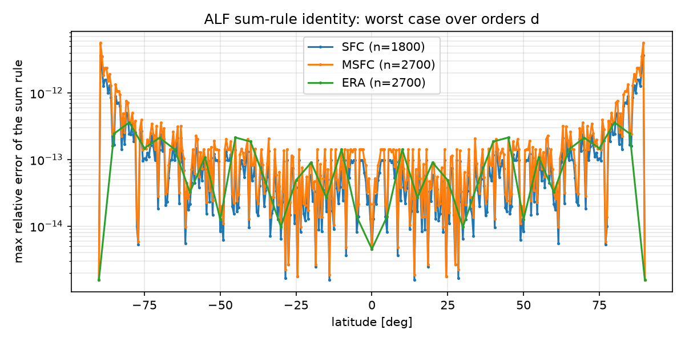
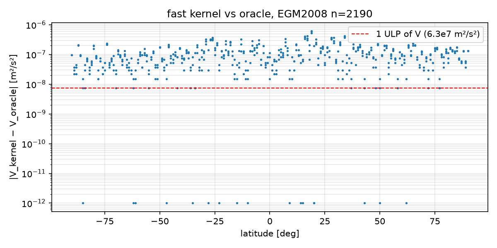

# ALF benchmark: Legendre functions and the production kernel

Two self-contained validations that need no external software. Both write CSVs to `results/` and are registered
in CTest (`ctest -R "AlfIdentities|KernelVsOracle"`). Figures: `plot_alf.py` -> `img/`.

## 1. Sum-rule identities (`test_alf_identities.cpp`)

For a maximum degree M the fully normalised functions and their colatitude derivatives satisfy closed-form sums
(I0 = (M+1)^2, I1 = M(M+2)(M+1)^2/4, I2, I3 in the file header; checked at 60 digits with mpmath). The test
evaluates the relative error of each sum at **every** degree M <= nmax along the whole meridian
(-90..90 deg, step 0.5 deg) for derivative orders d = 0..3, and for three algorithms.

| algorithm | nmax | latitudes | worst relative error (all d, all M) |
|---|---|---|---|
| SFC (standard forward columns) | 1800 | 361 | 3.6e-12 |
| MSFC (modified, extended range) | 2700 | 361 | 5.6e-12 |
| ERA (extended-range arithmetic) | 2700 | 37 | 3.6e-13 |

Acceptance thresholds (project-defined): M < 1800: 1e-12; 1800 <= M < 2190: 1e-10; M >= 2190: 1e-9; wider in
the polar strip 85..90 deg (O(M^2 eps) accumulation). A relative error > 1e-3, NaN or Inf is a hard failure.
All tests pass.



Columns of `results/alf_identities_<alg>_n<nmax>.csv`: `lat_deg, d, M_at_max, max_rel_error, max_M_lt_1800,
max_M_1800_2189, max_M_ge_2190`.

Honest reading: the sum rules check the *square-summed* functions, not each P_nm; a compensating error between
orders would not show. The per-point check is the kernel-vs-oracle test below and the comparison with GrafLab
(`../meridian`, `../shs`).

## 2. Production kernel against the oracle (`test_kernel_vs_oracle.cpp`)

The fused SIMD `fast` kernel is compared with the sequential oracle (`reference_point`) for the potential V of
EGM2008 (n = 2190) at 543 points along the meridian (varied longitudes), `results/kernel_vs_oracle_V_egm2008_n2190.csv`.

* Maximum |V_kernel - V_oracle| = **6.1e-7 m^2/s^2** at V ~ 6.3e7 m^2/s^2, i.e. relative 1e-14 (about 80 ULP of V).
* Both sums are rounding-limited on a large value; the absolute figure is the number a user sees.



Runtime of this test is about 6 min (the oracle is sequential and extended-range); it is not a speed benchmark.
Speed is reported in [`../shs`](../shs/results/Summary.md).

## Reproduce

```
cmake --preset clang && cmake --build build/clang
ctest --test-dir build/clang -R "AlfIdentities|KernelVsOracle"
python benchmark/alf/plot_alf.py     # needs numpy, matplotlib
```
