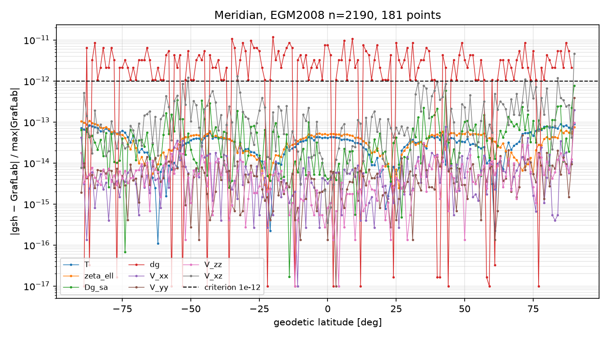

# Meridional benchmark: gsh against GrafLab

One meridian of the EGM2008 field (degree and order 2190, GRS80), evaluated with **gsh** (this project, C++) and
**GrafLab 2.1.4** (MATLAB, Bucha and Janak 2013) as ground truth. Each functional is compared point by point.

## Contents

```
benchmark/meridian/
  README.md                 this file
  CMakeLists.txt            gsh_meridian target (not yet wired into the root CMake; see "Wiring")
  gsh_meridian.cpp          gsh driver: 181 points, all functionals, writes the gsh CSV
  matlab/
    run_graflab_meridian.m  GrafLab driver (two headless calls), writes the GrafLab CSV
  compare_meridian.py       comparison, writes comparison.csv and comparison.md
  results/
    gsh_meridian.csv        gsh output (SI units)
    graflab_era_meridian.csv  GrafLab output (GrafLab units), written by the MATLAB runner
    graflab_msfc_meridian.csv, graflab_sfc_meridian.csv   the same with fnALFs 2 and 1
    comparison_modes.md/.csv  gsh and GrafLab modes against each other (all three recurrences)
    comparison.csv          difference metrics per functional
    comparison.md           the same as markdown, with conventions and diagnostics
```

GrafLab itself is **not** in the repository (see "GrafLab" below).

## Set-up

| Item | Value |
|---|---|
| Model | `data/cache/modelos/EGM2008/EGM2008.gfc`, read by both engines, full degree 2190 (header `max_degree 2190`, `norm fully_normalized`, `tide_system tide_free`) |
| GM, R | taken from the file by both engines: GM = 3.986004415e14 m^3/s^2, R = 6378136.3 m (GrafLab overwrites GM and R with the file's values for `.gfc` input) |
| Ellipsoid | GRS80: a = 6378137 m, e^2 = 0.00669438002290, GM_ell = 3.986005e14, J2 = 1.08263e-3, omega = 7.292115e-5 rad/s. The gsh default `Ellipsoid::GRS80()` has the same values |
| Points | latitude -90..+90 deg in steps of 1 deg (181 points), longitude 0 deg, h = 0 m (geodetic, GRS80) |
| Poles | included (+-90 deg) |
| Recurrence | GrafLab `fnALFs = 3` (extended-range arithmetic). gsh: `compute_functionals`, its production path |
| Degree | nmin = 0, nmax = 2190 (both engines) |

The user's values GM = 3986005e8 and J2, omega are the GRS80 set. For the model, both engines use the file's GM and R
(GrafLab cannot be given another GM for a `.gfc` file). The ellipsoid constants are GRS80 in both engines.

## Functional mapping

| Benchmark name | gsh `Functional` | gsh CSV column (SI) | GrafLab code | GrafLab column (GrafLab unit) | Conversion to SI |
|---|---|---|---|---|---|
| T, disturbing potential | `T` | `T_m2s2` | 5 | `T_m2s2` (m^2 s^-2) | none |
| zeta (height anomaly, ellipsoidal) | `zeta_ell` = T/gamma | `zeta_ell_m` | 22 (`zeta_Ell`) | `zeta_ell_m` (m) | none |
| Dg, gravity anomaly (spherical approx.) | `Dg_sa` | `Dg_sa_ms2` | 19 | `Dg_sa_mgal` (mGal) | x 1e-5 |
| dg, gravity disturbance (exact) | `dg` | `dg_ms2` | 20 | `dg_mgal` (mGal) | x 1e-5 |
| V_xx | `V_xx` | `V_xx_s2` | 14 | `Vxx_E` (Eotvos) | x 1e-9 |
| V_yy | `V_yy` | `V_yy_s2` | 14 | `Vyy_as_exported_E` (Eotvos) | x 1e-9 |
| V_zz | `V_zz` | `V_zz_s2` | 14 | `Vzz_E` (Eotvos) | x 1e-9 |
| V_xz | `V_xz` | `V_xz_s2` | 15 | `Vxz_E` (Eotvos) | x 1e-9 |

Notes on the mapping:

* **zeta**: the full height anomaly (GrafLab 23) needs a DTM file, which this benchmark does not have. gsh `zeta` also
  needs a height source. The comparison therefore uses zeta_Ell (GrafLab 22) against gsh `zeta_ell`. The full zeta is
  not compared.
* **Dg**: GrafLab's only anomaly is the spherical approximation (19). The exact gravity anomaly is not a GrafLab
  output, so no exact anomaly is compared.
* **V_yy sign**: GrafLab code 14 writes `[Vxx, -Vyy, Vzz]` (`GrafLab.m`, `Pg=[Pg -Vyy(:)]`). The comparison uses the
  column as exported. `compare_meridian.py` also reports a Laplace-residual check and the sign-flipped comparison, so
  the sign question is visible, not hidden.
* **dg at the poles**: gsh rejects `dg` at an exact pole (`1/cos phi` in g_y; `invalid_argument`), so `dg` is written
  as `nan` at lat = +-90 deg and the comparison uses 179 points for dg. GrafLab's own pole value is written as NaN
  if it is not finite.
* **Units**: gsh writes SI. GrafLab writes mGal and Eotvos. The conversion factors are exact powers of ten; they add at
  most one rounding per value.

## Conventions of the comparison

* d = gsh - GrafLab, point by point (points match by position: both files list -90..+90).
* `max abs(d)`: largest absolute difference. `scale`: largest |GrafLab| of the functional.
* **`max abs(d) / scale`** is the normalised difference used against the criterion (rounding level, 1e-12 to 1e-14).
  It is the primary number, because a pointwise relative difference is undefined where a functional crosses zero.
* `max rel(pt)`: largest |d|/|GrafLab| over points with a non-zero GrafLab value. Secondary.
* Tolerances are not changed to fit the results. A row that does not meet 1e-12 is reported as "no".

## How to run

Prerequisites: Windows, clang-cl with the project's CMake setup (the root `CMakePresets.json`, preset `clang`),
Python 3.12 venv with numpy (`.venv\Scripts\python.exe`), MATLAB R2026b, and GrafLab 2.1.4 (see below).

1. Build the driver (after the wiring below, from the repository root):
   ```
   cmake --preset clang
   cmake --build --preset clang --target gsh_meridian
   ```
2. Run gsh (about 5 s of synthesis plus the load of the 252 MB file):
   ```
   build\clang\bin\gsh_meridian.exe --gfc data\cache\modelos\EGM2008\EGM2008.gfc --nmax 2190 --lon 0 --out benchmark\meridian\results\gsh_meridian.csv
   ```
3. Run GrafLab (long: each call loads the whole model; allow a generous timeout, run in the background):
   ```
   matlab -batch "cd('benchmark\meridian\matlab'); run_graflab_meridian('data\cache\modelos\EGM2008\EGM2008.gfc', 'benchmark\meridian\results\graflab_era_meridian.csv', '<folder with GrafLab.m>', 3)"
   ```
   The third argument can be left empty when the environment variable `GRAFLAB_DIR` holds the folder.
4. Compare:
   ```
   .venv\Scripts\python.exe benchmark\meridian\compare_meridian.py
   ```
   If `graflab_era_meridian.csv` is missing, the script writes a status note and exits with code 1. For the
   other modes, run step 3 again with last argument `2` (output `graflab_msfc_meridian.csv`) and `1`
   (`graflab_sfc_meridian.csv`); `compare_meridian.py` then also writes `comparison_modes.md` and `.csv`.

## GrafLab

`GrafLab.m` (Bucha and Janak 2013, Computers and Geosciences 56, 186-196, doi:10.1016/j.cageo.2013.03.012) is not
redistributed here. Obtain it from its author (the `graflab-cookbook` repository) and check its terms. Point
`run_graflab_meridian.m` at the folder that contains `GrafLab.m`.

## Wiring (for the maintainer)

The root `CMakeLists.txt` is not edited by this benchmark. To build the driver with the other tools, add this line
inside the `if (GSH_BUILD_TOOLS)` block, next to the SHS benchmark:

```cmake
  add_subdirectory(benchmark/meridian)
```

## Results

Run on the reference set above (EGM2008, nmax 2190, lon 0 deg, 181 points; GrafLab era). Full detail in
`results/comparison.md`. Normalised column = max |d| / max |GrafLab|; criterion 1e-12.

| functional | max abs(d) | max abs(GrafLab) | normalised | meets 1e-12 |
|---|---|---|---|---|
| T [m^2 s^-2] | 4.6e-11 | 5.2e+02 | 9.0e-14 | yes |
| zeta_ell [m] | 5.6e-12 | 5.3e+01 | 1.1e-13 | yes |
| Dg_sa [m s^-2] | 1.2e-15 | 1.6e-03 | 7.7e-13 | yes |
| dg [m s^-2], 179 non-polar points | 9.2e-14 | 1.7e-03 | 5.5e-11 | **no** (see below: the miss is GrafLab's) |
| V_xx [s^-2] | 3.1e-19 | 1.6e-06 | 2.0e-13 | yes |
| V_yy [s^-2] | 6.1e-19 | 1.6e-06 | 3.9e-13 | yes |
| V_zz [s^-2] | 3.1e-19 | 3.1e-06 | 9.7e-14 | yes |
| V_xz [s^-2] | 2.8e-19 | 6.0e-08 | 4.7e-12 | **no** |

What this shows:

* The 1e-12 target is met for T, zeta_ell, Dg_sa and the four V components at the scale of each functional's
  maximum. It is not met for dg (5.5e-11) and V_xz (4.7e-12). These two are reported as they are; the binary128
  reference below shows that in both cases the difference comes from GrafLab, not from gsh.
* The absolute tensor differences are about 3e-19 s^-2 (largest at the poles). V_xz fails only because its own
  maximum on this meridian (6e-8 s^-2) is small compared with the others.
* V_yy: GrafLab's exported column is the one that satisfies the Laplace identity Vxx + Vyy + Vzz = 0
  (residual 1.7e-14 with the column as exported, 2.0 with its sign flipped). The gsh V_yy matches the exported column.
* Pointwise relative differences are large near zeros of each functional (for example dg 9.8e-9 at one point); the
  normalised column is the criterion.
* The poles: dg is not evaluated by gsh at lat +-90 (API limit), so dg is compared on 179 points only.
* The main table above is GrafLab era (fnALFs 3). The same runs with msfc (2) and sfc (1) are in the next section.
  The tensor was not compared for V_xy or V_yz (not requested).

## All GrafLab Legendre modes

GrafLab 2.1.4 was run on the same 181 points with its three recurrences (`fnALFs` = 3 era, 2 msfc, 1 sfc), and the
single gsh run was compared with each. Each GrafLab mode was also compared with GrafLab era, to measure the spread
of GrafLab itself. Metric and criterion are the same as above (max |d| / max |reference| <= 1e-12). Full table:
`results/comparison_modes.md` and `.csv`.

| functional | gsh vs era | gsh vs msfc | gsh vs sfc | GrafLab msfc vs era | GrafLab sfc vs era |
|---|---|---|---|---|---|
| T | 9.0e-14 | 9.3e-14 | 3.9e-05 | 9.7e-15 | 3.9e-05 |
| zeta_ell | 1.1e-13 | 1.2e-13 | 3.9e-05 | 9.7e-15 | 3.9e-05 |
| Dg_sa | 7.7e-13 | 5.7e-13 | 4.2e-03 | 5.1e-13 | 4.2e-03 |
| dg | **5.5e-11** | **2.7e-11** | 4.0e-03 | **5.0e-11** | 4.0e-03 |
| V_xx | 2.0e-13 | 7.6e-14 | 2.8e-04 | 1.4e-13 | 2.8e-04 |
| V_yy | 3.9e-13 | 1.3e-13 | 1.1e-03 | 2.6e-13 | 1.1e-03 |
| V_zz | 9.7e-14 | 5.3e-14 | 7.1e-04 | 5.9e-14 | 7.1e-04 |
| V_xz | **4.7e-12** | **1.4e-12** | 1.1e-02 | **3.3e-12** | 1.1e-02 |

What this shows (measured):

* sfc fails against both gsh and GrafLab era in every functional, by 4e-5 to 1e-2 of the scale. This is GrafLab's
  own standard forward column at degree 2190: it does not agree with its own era or msfc output. It is not a gsh
  result and it does not say anything about gsh.
* For dg and V_xz, the criterion 1e-12 is not met by **GrafLab against itself** either: msfc differs from era by
  5.0e-11 (dg) and 3.3e-12 (V_xz). The gsh-against-era differences (5.5e-11 and 4.7e-12) are of the same order as
  that spread. (Before gsh's dg was changed to the disturbing-potential form, the gsh-against-era value for dg
  was 1.2e-11; see the binary128 section.)
* The other six functionals meet 1e-12 for gsh against era and against msfc.
* The misses of dg and V_xz in the main table are therefore at the level of the noise between GrafLab's own correct
  modes. This does not explain their cause, and it does not change the result: they stay reported as "no".

Not established: why the sfc output diverges (a numerical range problem of the standard forward column at high
degree is the usual explanation in the literature, but it was not verified here), and which of GrafLab or gsh is
closer to the true value for dg and V_xz (answered by the extended-precision reference in the next section).

GrafLab provenance: `GrafLab.m`, "GrafLab 2.1.4" in its header, downloaded by the user on 2026-11-10, SHA-256
`b8ef4ea62cbd706fbabcfa850df271c75863b9f7b240a5c6cb6fbad2b4242b36`. Runs of 2026-11-12 on MATLAB R2026b; each
mode takes about 45 s (two calls of 18-23 s).


## Extended-precision reference (binary128)

`ref_quad/ref_quad.cpp` re-evaluates the same quantities in IEEE binary128 (113-bit mantissa, ~1e-34, exponent range
1e+-4932, so the sectoral underflow of double does not occur). Nothing is shared with gsh: Legendre recurrences, their
derivatives (non-singular identity for dP/dphi, Legendre ODE for d2P/dphi2, closed forms at the exact poles), the raw
sums and the functional formulas are written again. Coefficients, GM, R and the GRS80 constants are rounded to double
first, so the reference measures the arithmetic of the engines and not their inputs. Build and run in WSL:
`wsl -d Ubuntu-24.04 -e bash benchmark/meridian/ref_quad/build_and_run.sh` (about 1 min on 12 threads). Compare with
`compare_quad.py` (writes `results/comparison_quad.md` and `.csv`).

Validation of the reference itself: at n = 360 it agrees with gsh to 3e-15 (V_xx, V_zz) and 6e-14 (V_xz, both poles
included) of the scale; at n = 2190 the controls V_xx and V_zz agree with gsh to 1.6e-14 and 8e-15.

Error of each engine against the reference (max |engine - reference| / max |reference|; criterion 1e-12; the latitude
as exact decimal degrees or as the double radian the engines use gives the same table to two digits):

| functional | gsh | GrafLab era | GrafLab msfc |
|---|---|---|---|
| V_xz | 5.9e-13 (meets), max at -89 | **4.7e-12** (misses), max at +90 | **1.4e-12** (misses), max at +90 |
| dg, gsh as |g| - gamma (before the change) | **5.2e-11** (49 ULP of g) | | |
| dg, gsh from disturbing-potential derivatives (current) | 4.0e-13 (0.4 ULP) meets | **5.6e-11** (52 ULP) | **2.7e-11** (25 ULP) |
| V_xx, V_zz (controls) | <= 1.6e-14 | <= 9.7e-14 | <= 7.4e-14 |

What this shows (measured):

* **V_xz:** gsh is closer to the exact value than GrafLab. The 4.7e-12 miss of the main table is GrafLab's error at the
  pole (its maximum is at +90 deg); gsh meets 1e-12 against the reference. This is a statement about the reference
  built here, not about the definition of the functional.
* **dg:** with the original formulation dg = |g| - gamma, none of the three engines met 1e-12 against the exact value
  (gsh 49 ULP of g, GrafLab era 52, msfc 25; 1 ULP of 9.8 m/s^2 is 1.78e-15 m/s^2). The hypothesis was that the
  subtraction of two numbers of about 9.8 m/s^2 (difference of order 1e-3) dominates the error. It was tested by
  changing gsh to dg = (2 gamma.delta + |delta|^2) / (|gamma + delta| + |gamma|), where delta = -grad T is built only
  from the disturbing sums (algebraically identical to |g| - gamma, with no 9.8 m/s^2 subtraction). Result: the error
  of gsh falls from 5.2e-11 to 4.0e-13 (0.4 ULP of g, largest at +75 deg), i.e. it now meets 1e-12 and is two orders
  below the old value. GrafLab (era 5.6e-11, msfc 2.7e-11) keeps the |g| - gamma form and does not meet it. The
  hypothesis is therefore confirmed for dg by an intervention, not only by correlation. The same engines meet 1e-12 for
  Dg_sa (7.7e-13), which also has no 9.8 m/s^2 term.
* The 1e-12 criterion is the one fixed beforehand; it was not changed.

## Figure

`plot_meridian.py` writes `img/meridian_gsh_vs_graflab.png`: |gsh - GrafLab| / max|GrafLab| per functional along
the meridian, with the 1e-12 criterion. against GrafLab, dg and V_xz exceed it (5.5e-11 and 4.7e-12); the absolute differences are
9e-14 m/s^2 and 3e-19 s^-2. The binary128 reference attributes both to GrafLab (see above).

V_xz was checked against the data: it does NOT vanish at the equator or the poles (4.6e-9, 4.8e-10 and 1.9e-9 s^-2 at
0, -90 and 90 deg); it changes sign 48 times along the meridian, and its scale (max 6.0e-8 s^-2) is small, which inflates
the normalised figure. The median |gsh - GrafLab| is 6e-21 s^-2; the maximum (2.8e-19) is at the pole, where the
relative difference is 1.5e-10. The pole is the conditioning-limited point (1/cos phi), so the miss is concentrated there.
The dg maximum against GrafLab era is 9.2e-14 m/s^2 (that of the previous gsh formulation was 2.0e-14 at -20 deg).



## Technical notes on the two misses against GrafLab

Established (checked on the data or in the code):

* V_xz is not zero at the poles. A non-zonal field has order m = 1 terms, whose latitudinal derivative does not vanish
  there; the same value appears in GrafLab (4.77e-10 s^-2 at -90 deg, 1.9e-9 s^-2 at 90 deg).
* The largest V_xz difference is at the pole (2.8e-19 s^-2, relative 1.5e-10); elsewhere the median is 6e-21 s^-2.
  The horizontal tensor and derivative formulas contain 1/cos(phi) (see Fukushima 2012 on the derivatives and the
  non-singular tensor of Petrovskaya and Vershkov 2006 as used in GrafLab).
* gsh's dg also contains 1/cos(phi) and is rejected at the exact poles (`functionals.cpp`), so it is not a
  pole-stable functional in this implementation.

Not established (hypotheses, not verified):

* Why the V_xz error of GrafLab is concentrated at +90 deg (it is measured there; the cause in GrafLab's code was not
  investigated).
* "Last bit of agreement": the median V_xz difference is 6e-21 on values of order 1e-8, a relative 1e-12, not 1e-16.
