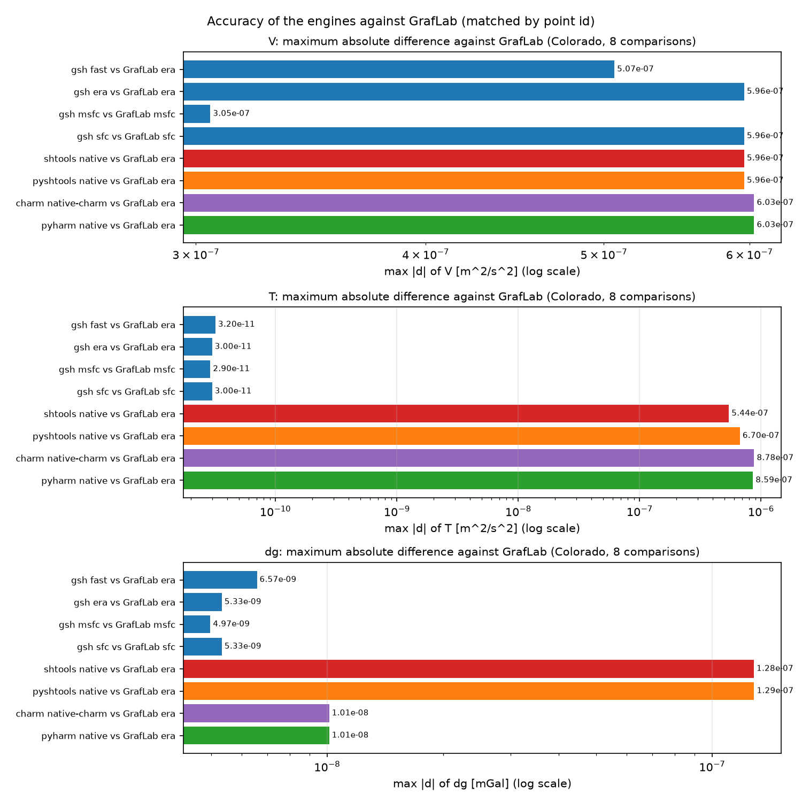
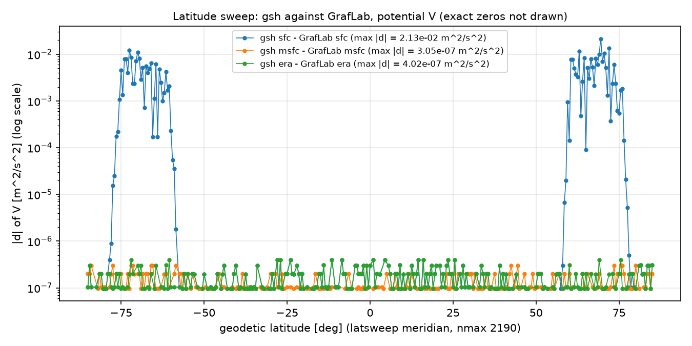
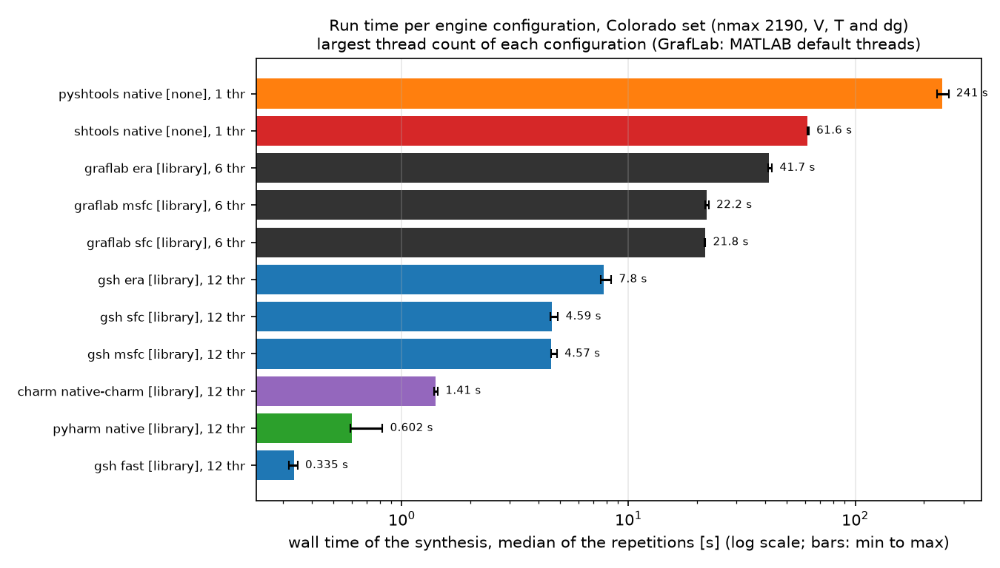
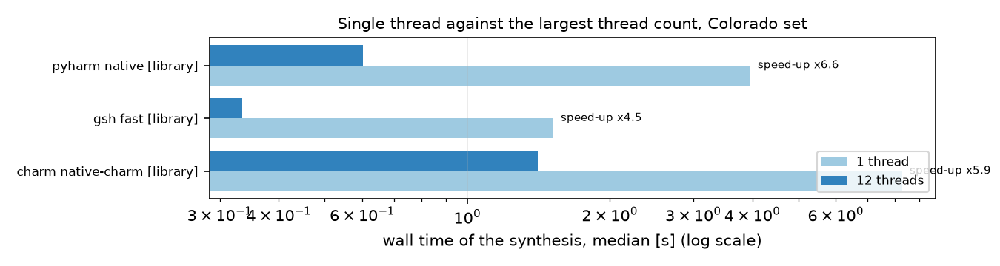
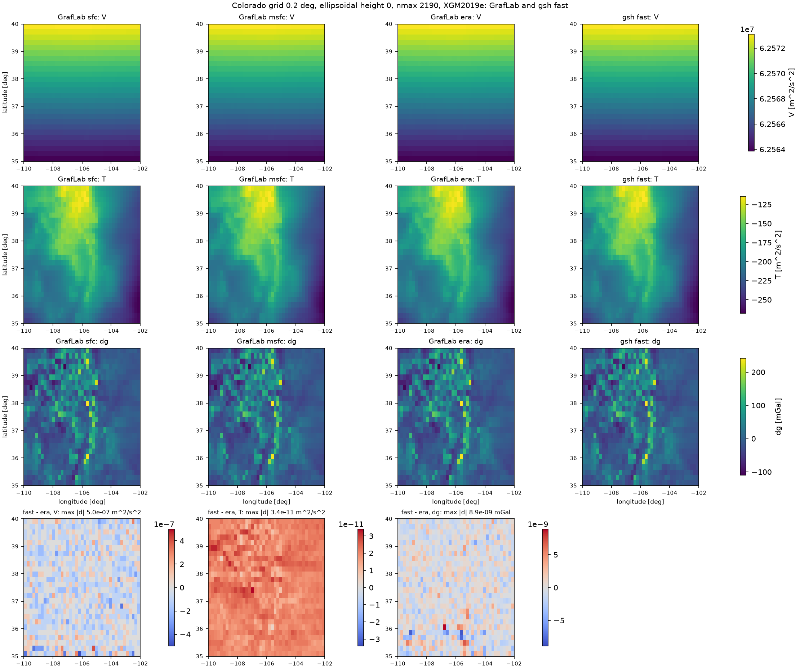

# Spherical-harmonic synthesis benchmark: summary

This page is self-contained: it says what was computed, how, and what came out. The column-by-column definition
of every CSV is in [`csv.md`](csv.md); the step-by-step replication guide is in [`../README.md`](../README.md);
the origin of the model and of the points is in [`../data/DATA.md`](../data/DATA.md).

**Question.** Does gsh (this project, C++) reproduce the spherical-harmonic synthesis of the established tools,
and how fast is it?

| role | engine (official, as-distributed form) |
|---|---|
| accuracy reference | **GrafLab** 2.1.4 (MATLAB) |
| efficiency reference | **CHarm** 0.4.11 (C library), driven as one call from C and from Python (**pyharm** 0.4.11) |
| general reference | **SHTOOLS** 4.14.1 (Fortran), driven serially from Fortran and from Python (**pyshtools** 4.14.1) |
| engine under test | **gsh** (C++20, OpenMP + SIMD) |

**Test case.** XGM2019e (tide-free, degree/order 2190), n = 2190, two point sets:
*colorado* (509 GPS/levelling benchmarks, latitudes 35° to 40°) and *latsweep* (341 points along a meridian,
−85° to 85°, to stress the polar regime of the recurrences). Every run computes V (gravitational potential) and T
(disturbing potential), both in m²/s², and dg (gravity disturbance, mGal), in one pass. Three repetitions of every
configuration; times are the synthesis only (model loading excluded).

## 1. Headline results

* **Accuracy.** gsh `fast` agrees with GrafLab to 5.1e-7 m²/s² in V, 3.2e-11 m²/s² in T and 6.6e-9 mGal in dg on
  Colorado (4.0e-7, 4.4e-11, 2.0e-9 on the latitude sweep). V is about 6.3e7 m²/s², so this is 1e-14 relative.
  The CHarm, pyharm, SHTOOLS and pyshtools values lie within 6e-7 m²/s² of GrafLab in V.
* **Speed.** On Colorado (V, T and dg together), 12 threads: **gsh `fast` 0.39 s**, pyharm 0.60 s, CHarm driver
  1.41 s, GrafLab 21.8 to 41.7 s (6 MATLAB threads), SHTOOLS 61.6 s (serial), pyshtools 241 s (serial). gsh `fast`
  is 1.5 times faster than pyharm, 3.6 times faster than the CHarm driver and 55 to 106 times faster than GrafLab.
  With one thread, gsh `fast` takes 1.49 s against 3.96 s (pyharm) and 8.29 s (CHarm): 2.7 and 5.6 times faster.
  The reference recurrences of gsh (`sfc`, `msfc`, `era`, 12 threads) take 7.2 to 8.9 s, 2.9 to 4.7 times faster
  than the same recurrences in GrafLab.
* **One open item** (section 6): the CHarm C driver is 2.1 to 2.3 times slower than pyharm. The former V offset of
  the reference recurrences of gsh (`sfc`, `msfc`, `era`: 1.1e-5 against 5.1e-7 m²/s² for `fast`) was explained and
  closed: it was the plain `double` accumulation of 2.4 million terms in the driver, and Neumaier compensated
  summation brings them to 3e-7 to 6e-7 m²/s². A defect of gsh `sfc` near ±60° found by the latitude sweep is
  also fixed (section 6).

## 2. Files in this folder

| path | content |
|---|---|
| `Summary.md` | this page |
| `csv.md` | what every CSV contains, column by column |
| `csv/graflab/` | `res_time.csv`, `res_value.csv` of GrafLab |
| `csv/charm/` | `res_time.csv`, `res_value.csv`, `comp_value.csv` for CHarm (C driver) and pyharm |
| `csv/shtools/` | same, for SHTOOLS (Fortran driver) and pyshtools |
| `csv/gshtools/` | same, for gsh; `comp_value.csv` compares gsh with GrafLab |
| `raw/` | per-run outputs, `timings.csv`, `summary_tables.md` (generated; not versioned) |
| `../img/` | the figures below, including `map_colorado_grid_graflab_vs_gsh.png` (final spatial comparison) |

`res_value.csv`: one row per engine, recurrence, set and point, with V, T and dg. `res_time.csv`: one row per
engine, recurrence, set and thread count, with the median, minimum and maximum wall time over the repetitions,
CPU time, model-loading time and the parallel mode (`library`: the library's own OpenMP, or `none`: serial).
`comp_value.csv`: difference of two engines at each point (mean, RMS, minimum, maximum, maximum absolute value).
Full definitions in [`csv.md`](csv.md).

`recurrence` is `sfc`, `msfc` or `era` (GrafLab `fnALFs` 1, 2, 3; also implemented in gsh), `fast` (the gsh
production kernel: MSFC fused with the sum, no triangle stored, OpenMP over points) or `native` (CHarm, pyharm,
SHTOOLS and pyshtools have a single algorithm).

## 3. Inputs

| file (in `data/`) | content |
|---|---|
| `XGM2019e_2190_tide_free.gfc.xz` | XGM2019e (Zingerle et al. 2020, CC BY 4.0), degree 2190, tide-free. Derived from the zero-tide `XGM2019e_2159.gfc` by changing only C20 (+4.173576e-9). Every engine reads the same file; the uncompressed 281 MB file is not versioned, and the `.xz` is a GitHub Release asset (`data-v1`) in the public repository. |
| `SHA256SUMS.txt` | SHA-256 of the original, of the derived file and of the `.xz`, to check that you hold the very same model |
| `points_colorado.csv` | `id,lat_deg,lon_deg,h_m`: 509 points, geodetic latitude on GRS80, ellipsoidal height |
| `points_latsweep.csv` | 341 points, −85° to 85° in steps of 0.5° |
| `DATA.md` | origin and derivation |

The tide system does not matter for comparing engines (all read the same file); it matters only for the physical
meaning of the values.

## 4. How each engine was run

Common rules: same model, same points, nmax 2190, nmin 0, no engine applies a tide conversion. **Every tool is
used in its official form and no parallelism is added to a tool that does not provide it.** One engine at a time,
machine otherwise idle, 3 repetitions.

| engine | how | threads | parallel mode |
|---|---|---|---|
| gsh | driver `code/cpp/gsh_shs_bench.cpp`. `fast`: `gsh::compute_functionals`. `sfc`, `msfc`, `era`: per-point Legendre triangle from `legendre::sfc/msfc/era` and the raw sums of the driver | `fast` 12 and 1; others 12 | library (OpenMP over points) |
| GrafLab | `code/matlab/run_graflab.m`, headless `GrafLab('OK', ...)`, point-wise, ellipsoidal coordinates, GRS80, `fnALFs` 1/2/3, `Functional` = [11;5;20] | 6 (MATLAB default) | library |
| CHarm | `code/c/charm_shs_bench.c`: **one** library call over all points, CHarm's internal OpenMP (over orders m) | 12 and 1 | library |
| pyharm | `code/python/run_pyharm.py`: `pyharm.shs.point` / `point_grad1` | 12 and 1 | library |
| SHTOOLS | `code/fortran/shtools_shs_bench.f90`, plain serial loop of `MakeGridPoint` | 1 | none |
| pyshtools | `code/python/run_pyshtools.py`, `MakeGridPoint` | 1 | none |

Definitions that differ between engines:

* **V**: full gravitational potential, degree 0 included, no normal potential subtracted.
* **T** = V − U. gsh and GrafLab use the GRS80 normal potential from the zonal series; the other four use the
  closed-form GRS80 potential. The two differ at the 1e-6 m²/s² level, so T and dg of CHarm, pyharm, SHTOOLS and
  pyshtools differ from GrafLab by about that much (visible in section 6) and agree with each other much better.
* **dg** = |g| − γ, centrifugal term included in g. GrafLab needs nmin = 0, so its T includes ΔC00 ≈ −9.2 m²/s².
* **GrafLab timing**: GrafLab parses the `.gfc` on every call (about 9 s here, 31 s in the `era` runs); its
  synthesis time is the total call time minus that load, recorded in `load_s_median`.

Reproduce (needs gsh built with the `clang` preset, the Python venv, MSYS2 UCRT64 for CHarm and SHTOOLS, MATLAB and
`GrafLab.m`; details in [`../README.md`](../README.md)):

```
set GRAFLAB_DIR=<folder with GrafLab.m>
set MATLAB_EXE=<path to matlab.exe>
set MSYS2_UCRT64_BIN=<path to msys64\ucrt64\bin>
pwsh benchmark/shs/code/run_all.ps1 -Sets colorado,latsweep     # all engines, about 1 hour
pwsh benchmark/shs/code/run_all.ps1 -OnlyGsh -Sets colorado,latsweep   # gsh only, with regression check
```

## 5. Test machine

| item | value |
|---|---|
| OS | Windows 11 Home, build 10.0.26300 |
| CPU | AMD Ryzen 7 7445HS, 6 cores / 12 threads |
| RAM | 15.3 GiB |
| gsh | clang-cl 22.1.3, Release with `/O2` (AVX-512 kernels, `-mavx512f -mfma`), preset `clang`, source commit 3576ad1 plus the uncommitted reorganisation |
| CHarm, SHTOOLS drivers | GCC / GFortran 16.2.0 (MSYS2 UCRT64), `-O3 -march=native -fopenmp` (CHarm driver) |
| Python / numpy | 3.12.14 / 2.5.4 |
| pyshtools / pyharm | 4.14.1 / 0.4.11 |
| MATLAB | R2026b (GrafLab 2.1.4) |

## 6. Accuracy

d = first engine − second engine at each point, matched on `id`. gsh `sfc`, `msfc`, `era` are compared with
GrafLab of the same recurrence; the single-algorithm engines and gsh `fast` with GrafLab `era`. The complete
tables (every pair, both sets, V, T, dg) are in `raw/summary_tables.md` and `csv/*/comp_value.csv`.



**Colorado, max |d| (509 points)**

| engine | reference | V [m²/s²] | T [m²/s²] | dg [mGal] |
|---|---|---|---|---|
| gsh fast | GrafLab era | 5.1e-07 | 3.2e-11 | 6.6e-09 |
| gsh sfc | GrafLab sfc | 6.0e-07 | 3.0e-11 | 5.3e-09 |
| gsh msfc | GrafLab msfc | 3.1e-07 | 2.9e-11 | 5.0e-09 |
| gsh era | GrafLab era | 6.0e-07 | 3.0e-11 | 5.3e-09 |
| pyharm | GrafLab era | 6.0e-07 | 8.6e-07 | 1.0e-08 |
| CHarm | GrafLab era | 6.0e-07 | 8.8e-07 | 1.0e-08 |
| pyshtools | GrafLab era | 6.0e-07 | 6.7e-07 | 1.3e-07 |
| SHTOOLS | GrafLab era | 6.0e-07 | 5.4e-07 | 1.3e-07 |
| pyharm | CHarm | 2.0e-07 | 4.0e-07 | 3.4e-09 |
| pyshtools | SHTOOLS | 1.0e-07 | 5.5e-07 | 4.1e-09 |

Read these numbers against the resolution of V: V ≈ 6.3e7 m²/s², and the CSV keeps 15 significant digits, so
differences of V below about 1e-7 m²/s² are rounding, not signal. An equivalent height is d/9.81 m/s²: 1e-5 m²/s²
is 1 µm.

### Latitude sweep (341 points, −85° to 85°)



Max |d| of V against GrafLab: gsh `fast` 4.0e-7, `msfc` 3.1e-7, `era` 4.0e-7 m²/s²: the same level as on
Colorado, with no polar degradation. For `sfc` two things appear:

1. From about |latitude| 60° to 77°, both gsh `sfc` and GrafLab `sfc` differ from `era` by 1e-3 to 1e-2 m²/s²
   (gsh sfc − GrafLab sfc is of that size too). This is the known underflow of the plain SFC recurrence at high
   degree near the poles, present in both implementations.
2. **Defect found and fixed in gsh `sfc`.** The first run gave errors from 5.6e9 to 8.2e14 m²/s² at latitudes
   ±59.5° and ±60°. Cause: the sectorial product `sect *= d_m u` stalls in the denormal range when `d_m u` is a
   little above 0.5 (latitude near 60°): the smallest denormal (4.9e-324) rounds back to itself and never reaches
   zero, every later column is seeded with it, and the forward recurrence amplifies it to about 1e23. GrafLab
   computes `u^m` by a power and is not affected. Fix in `legendre::sfc`: below the smallest normal number the
   value is rebuilt from the running log sum. Regression test `Legendre.SfcUnderflowsToZeroInsteadOfBlowingUp`.
   After the fix, gsh `sfc` against GrafLab `sfc` on the sweep: max |d| V 2.1e-2, T 2.1e-2 m²/s², dg 0.69 mGal,
   which is the documented SFC inaccuracy band (56° to 80°) present in both implementations.

### Resolved: V offset of the gsh reference modes

On the first run, gsh `sfc`/`msfc`/`era` differed from GrafLab by 1.1e-5 m²/s² in V on Colorado (1.8e-5 on the latitude
sweep), against 5.1e-7 for `fast`. The cause was the driver, not the Legendre functions or the kernel: it accumulated
the 2.4 million terms of each raw sum in one plain `double`, whose rounding error grows as about √N·ε (≈1e-13
relative, 1e-5 m²/s² in V). The same accumulation in `reference_point()` gave up to 2.0e-5 m²/s² against the production
kernel (`benchmark/alf/test_kernel_vs_oracle.cpp`). With Neumaier compensated summation in both, the differences with
GrafLab are V 6.0e-7 (`sfc`, `era`) and 3.1e-7 (`msfc`) on Colorado, V 3.1e-7 (`msfc`) and 4.0e-7 (`era`) on the sweep,
and dg 5e-9 mGal, the same level as `fast`. The gsh times of `sfc`/`msfc`/`era` in section 7 were measured before this
change; the compensated sum adds a little work to the per-point loop and those times must be re-measured on an idle
machine. The accuracy figures above are not affected by the CPU load.

### Open items

* **CHarm driver against pyharm**: the same CHarm library is 2.1 to 2.3 times slower from the C driver than from
  pyharm (section 7). Both make the same calls. Not yet explained; the compiler and flags of the library build
  are the first suspects. The pyharm numbers are the faster of the two efficiency references; gsh `fast` is
  faster than both.

## 7. Computation time

Wall time of the synthesis, V, T and dg together, median of 3, in seconds. Complete table, with minimum, maximum
and CPU time: `raw/summary_tables.md` and `csv/*/res_time.csv`.



| engine / recurrence | threads | Colorado (509 pts) | latsweep (341 pts) |
|---|---|---|---|
| **gsh fast** | 12 | **0.39** | **0.23** |
| pyharm | 12 | 0.60 | 0.55 |
| CHarm driver | 12 | 1.41 | 1.14 |
| gsh sfc | 12 | 7.18 | 4.39 |
| gsh msfc | 12 | 7.54 | 4.59 |
| gsh era | 12 | 8.91 | 5.68 |
| GrafLab sfc | 6 (MATLAB) | 21.8 | 14.7 |
| GrafLab msfc | 6 (MATLAB) | 22.2 | 15.2 |
| GrafLab era | 6 (MATLAB) | 41.7 | 34.9 |
| SHTOOLS (Fortran) | 1 | 61.6 | 39.1 |
| pyshtools | 1 | 241 | 125.9 |
| **gsh fast** | 1 | **1.49** | **0.95** |
| pyharm | 1 | 3.96 | 3.75 |
| CHarm driver | 1 | 8.29 | 8.00 |



Observations:

* One thread, same work: gsh `fast` 1.49 s, pyharm 3.96 s, CHarm 8.29 s. gsh is faster per core than both.
* gsh `fast` scales only 3.8 times from 1 to 12 threads (pyharm 6.6, CHarm 5.9; the machine has 6 physical
  cores). The run lasts 0.39 s, so thread start-up and load imbalance weigh on it: at 509 points and 12 threads
  each thread gets about 40 points, and the longest tile sets the time. It is the next thing to look at.
* The reference recurrences of gsh (`sfc`, `msfc`, `era`) are 2.9 to 4.7 times faster than the same recurrences
  in GrafLab (21.8, 22.2 and 41.7 s).
* The gsh timings of an earlier run of this benchmark were taken with a build that had no optimisation
  (a stale CMake cache left `CMAKE_CXX_FLAGS_RELEASE` empty and clang-cl ignores `-O3`). The values did not
  change (regression check passed), only the times; the CMake files now force `/O2` for Release.
* The serial SHTOOLS and pyshtools are the slowest by far; the Python wrapper is 3.9 times slower than the Fortran
  driver on the same library.
* Times are not comparable across thread counts, and GrafLab runs on 6 threads (MATLAB default), the others on 12 or 1.

## 8. Limitations

* One machine, one model (tide-free, derived by changing C20 only), one degree (2190).
* gsh T and dg differ from the other four engines' T and dg by the normal-potential implementation (section 4).
* Reproducibility is at round-off level, not bit-identical: the 1-thread and 12-thread runs of pyharm and CHarm
  differ by up to 5e-7 m²/s² in V (`raw/summary_tables.md`, thread check); gsh `fast` does not (0 on Colorado).
* The open item in section 6 (CHarm driver) is not resolved; it does not change the ranking of the engines in section 7.
  The V offset of the gsh reference modes is resolved (section 6), but their times in section 7 predate the fix.

## 9. Final comparison of the results



Spatial view of V, T and dg over Colorado (35° to 40° N, 110° to 102° W), on a regular 0.2° grid
(`data/points_grid.csv`, 1066 points, ellipsoidal height 0), nmax 2190, XGM2019e: the three GrafLab recurrences and
the gsh production kernel (`fast`), one colour scale per row. The last row is the difference gsh `fast` − GrafLab
`era` with its own scale (max |d|: V 5.0e-7 m²/s², T 3.4e-11 m²/s², dg 8.9e-9 mGal). The grid is synthesised only for this figure (one repetition, not part of the timed
benchmark); it is produced by `code/run_maps.ps1` and drawn by `code/python/plot_maps.py`.
